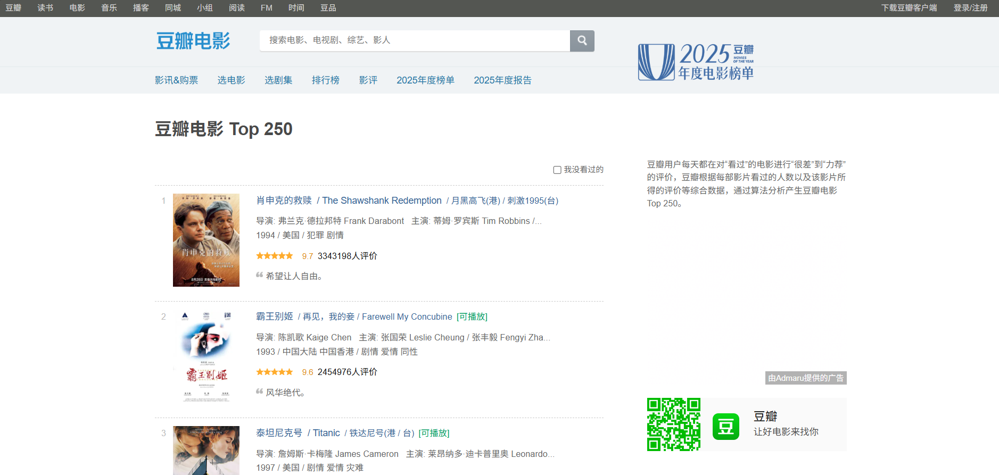
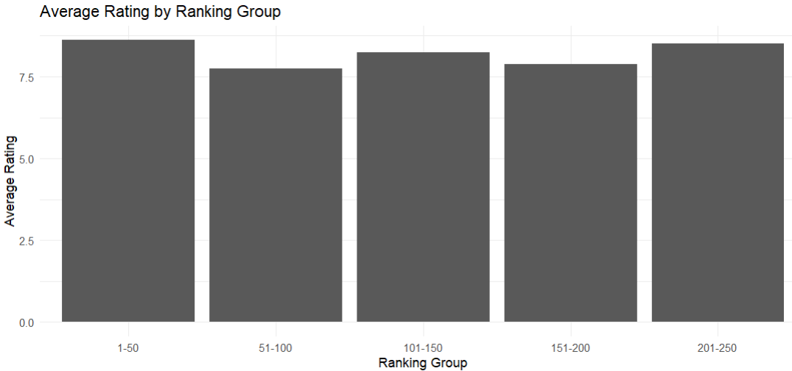
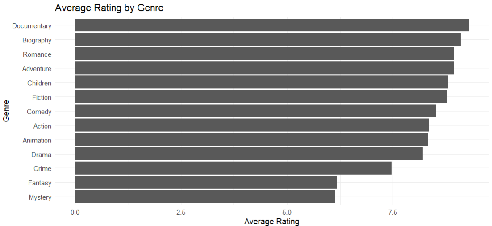
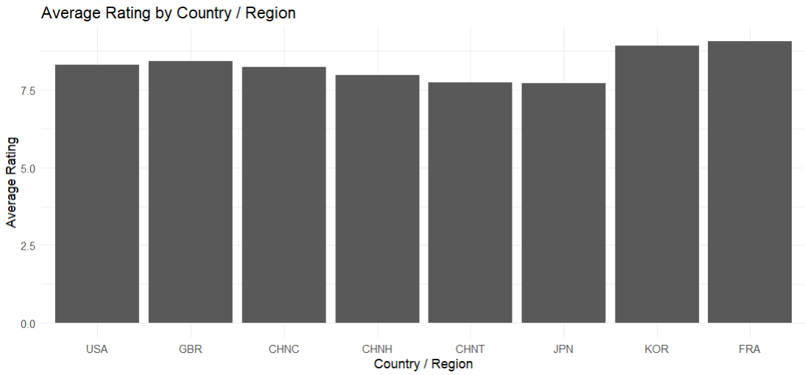
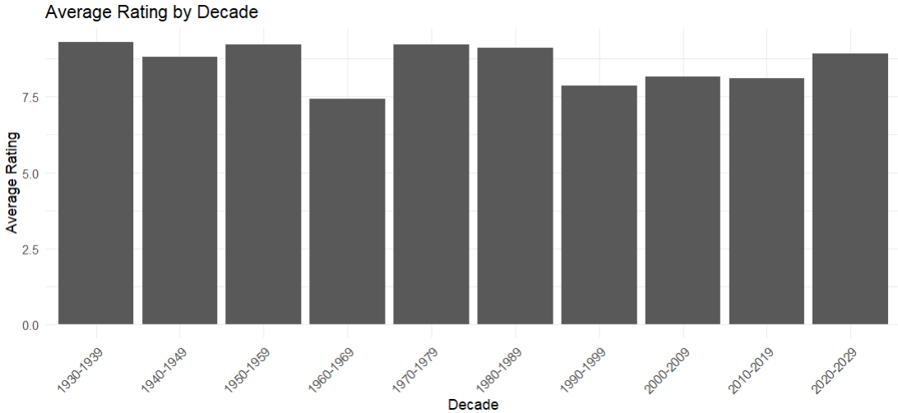

## Introduction

Douban, a popular film and book review website from China, has a good reputation and a large audience who rate and comment on films and books from different countries and time periods. It is particularly known for its Top 250 film list, which ranks highly regarded films from around the world. The list is widely used by viewers looking for well-reviewed films. As a film fan, I have frequently referred to this list, along with individual ratings and reviews, when selecting films to watch.

The ranking of the list is calculated using an algorithm based on weighted ratings from different reviewers. The weighting system takes reviewers' overall rating behavior into account, making the ranking different from the simple average rating that is directly displayed to users. This distinction raises an important question: once a film has entered the Top 250, does its visible average rating still provide useful information about its position within the list?

The question is especially relevant because the Top 250 already consists of highly rated films, so the range of visible ratings is relatively narrow. If average ratings are similar across different parts of the ranking, then a film's visible rating may provide little additional information about how highly it is ranked. At the same time, ratings may differ systematically across genres and countries because audiences can have different preferences for different types of films.

Therefore, this blog answers two specific questions: 

**(1) Do visible average ratings vary systematically with a film's position in the Top 250?**

**(2) Do average ratings differ systematically across film genres and countries?**

Answering these questions can help us determine whether visible ratings are a useful tool for comparing films within the Top 250, or whether they should be interpreted in the context of a film's characteristics.

## Data Analysis

In this blog, we employ RVEST using R to scrape data on the top 250 film list from the Douban website, attempting to answer these questions through some simple data analysis. We collect data on the ranking, country, year, and genre of each film within the Top 250 list, and again, employ R to conduct analysis and visualization.We group films respectively according to the ranking (50 films a group), production year (a decade for each group),the genre, and the country (we only analyze the major countries here). We then calculate and plot the average rating for each group.

We first discover that the average rating does not necessarily correlate with the ranking of a film. Indeed, we do not observe a downward trend of average ratings along with rankings (the invisible effective ratings follow this rule, as they are exactly the reference of the ranking!). Therefore, we may tell that the visible average ratings plays an insignificant part within this top list, as the effective rating is hardly correlated with the visible rating.

We then check if different categories of films would exhibit different ratings. Different categories are not supposed to be assigned with different art values, therefore this might indicate some preferences of Chinese audience.

Regarding genre, we find that fantasy and mystery films receive particularly low scores, and crime films receive lower scores to some degree as well. It could be speculated that these are relatively niche genres, which possess relatively fewer audiences with strong preferences. Other genres generally receive high scores, with documentaries receiving the highest rating.

Moving to the category of country, because countries of production are relatively centralized for top films, we select some major countries for comparison, including China Hongkong, China Macao, China Taiwan, France, Britain, the U.S., Japan and South Korea. We find that Chinese audience seems to be critical on home country films compared with western major countries. A special finding is that Japan receives particularly low ratings, while South Korean films are highly recognized. This may also be explained by subjective tastes.

Another attempt we made is to group years of production and see if there are any regularities. We find steady fluctuations by decades, without a strong direction of trend.

## Takeaways

**Visible ratings add limited information within the Top 250.** Average ratings show little relationship with ranking, so small rating differences should not be over-interpreted.

**Ratings differ across genres and countries.** Fantasy, mystery, and Japanese films receive relatively lower ratings, while documentaries and South Korean films receive higher ratings, suggesting differences in audience preferences.

**Use ratings as a reference, not a final decision rule.** When choosing a film, viewers should consider ranking, genre, country, and personal preferences together rather than relying only on the visible rating.