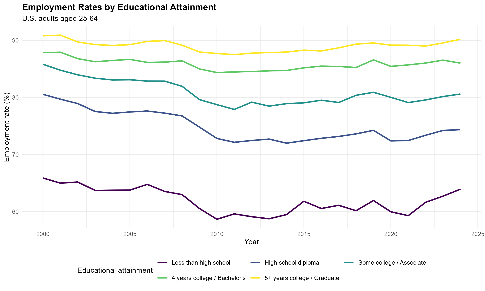
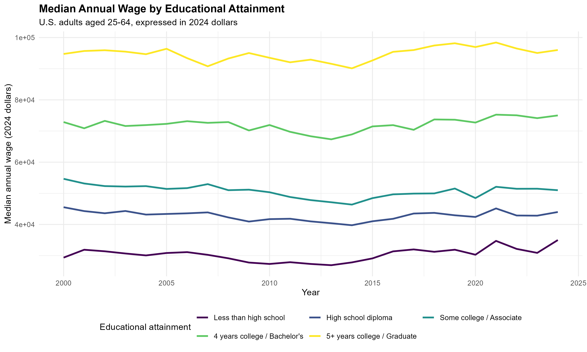
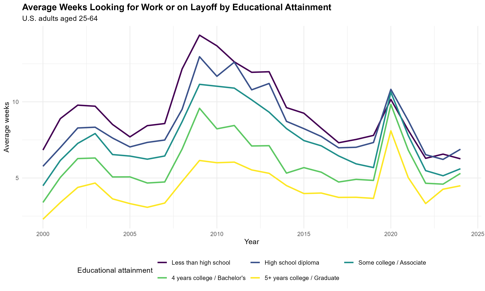

## Research Question

Educational attainment is closely associated with labor market outcomes. People with higher levels of education may have better employment opportunities, higher earnings, and more stable labor market experiences. At the same time, these relationships may change over time as the broader economic environment changes.

This blog post explores the following question:

**how are educational attainment and labor market outcomes related in the United States, and how does this relationship change over time?**

The analysis focuses on U.S. adults aged 25-64 from 2000 to 2024. Individuals are divided into five groups according to educational attainment: less than high school, high school diploma, some college or an associate degree, four years of college or a bachelor's degree, and five or more years of college or a graduate degree.

## Data and Mechanism

The data come from the Annual Social and Economic Supplement (ASEC) of the Current Population Survey (CPS). The analysis uses `EDUC` to measure educational attainment and `WORKLY`, `INCWAGE`, and `WKSUNEM1` to measure different aspects of labor market outcomes. Individual-level ASEC sampling weights are used throughout the analysis.

Educational attainment is the main grouping variable. For each education group and year, we compare three outcomes: the share of individuals who worked during the year, median annual wage income, and the average number of weeks spent looking for work or on layoff. This descriptive approach allows us to examine how labor market outcomes differ across education groups and how these differences evolve over time.

## Findings

The first figure shows a clear and persistent positive relationship between educational attainment and employment. Individuals with higher levels of education are consistently more likely to have worked during the year. The gap between education groups remains substantial throughout the period: the employment rate is around 90% for individuals with five or more years of college, compared with roughly 60%-65% for those with less than a high school education.

The figure also suggests that employment outcomes are more volatile among less-educated groups. The decline around the 2008 financial crisis is particularly pronounced for individuals with less than a high school education, while the highest-education groups show relatively smaller changes over time.

The second figure shows an even larger and persistent gap in earnings. Individuals with higher educational attainment consistently have higher median annual wage income. Throughout the period, the highest-education group has a median wage roughly three times that of the lowest-education group.

Although all education groups experience some fluctuations over time, the ranking across education groups remains remarkably stable. The gap in earnings therefore appears to be a persistent feature of the labor market rather than a pattern specific to a particular period.

The third figure measures the average number of weeks that individuals spent looking for work or on layoff during the year. The pattern is again strongly associated with educational attainment. Individuals with less education generally spend more weeks in this status, while those with higher education spend fewer weeks.

The differences become particularly pronounced during periods of labor market disruption. Around the 2008 financial crisis, average weeks looking for work or on layoff increased substantially across all education groups, with the largest increases among the less-educated groups. A similar spike appears around 2020. Despite these common fluctuations, the education ranking remains broadly consistent over time, with less-educated groups generally experiencing longer periods of looking for work or being on layoff.

This measure should be interpreted as the average number of weeks looking for work or on layoff among individuals for whom `WKSUNEM1` is applicable. It does not measure the time required to find a job.

## Takeaways

- **Higher education is consistently associated with better labor market outcomes.** More-educated individuals are more likely to have worked during the year and have substantially higher median wages.

- **The education gap extends beyond employment and earnings.** Less-educated individuals generally spend more weeks looking for work or on layoff, suggesting less favorable labor market experiences.

- **Economic downturns affect all education groups, but not equally.** The 2008 financial crisis and the 2020 shock are visible across the figures, with larger fluctuations generally appearing among less-educated groups.

- **The overall education ranking is remarkably stable over time.** Despite changes in the broader economic environment, the relative ordering of education groups remains broadly consistent across employment, earnings, and weeks looking for work or on layoff.

- **These findings are descriptive rather than causal.** The observed differences may also reflect other factors, such as work experience, occupation, industry, and demographic characteristics. Therefore, the analysis documents the relationship between education and labor market outcomes rather than identifying a causal effect of education.