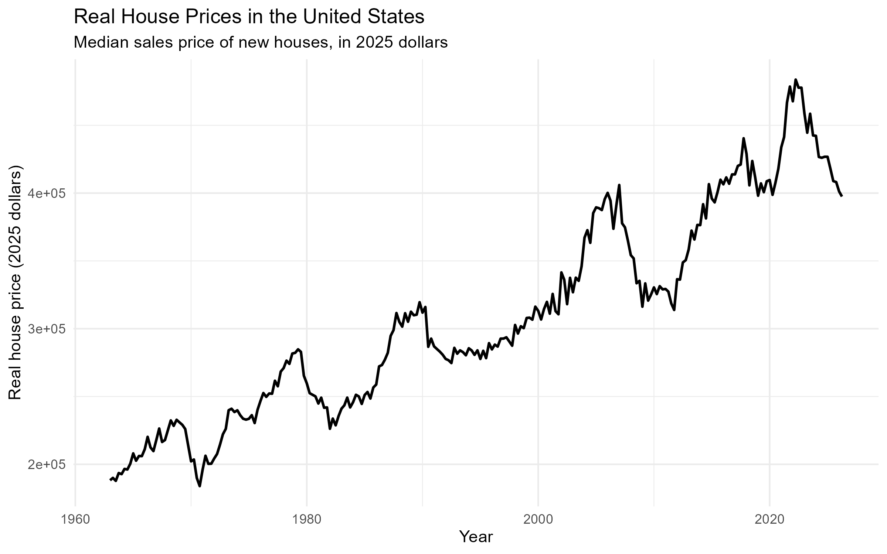
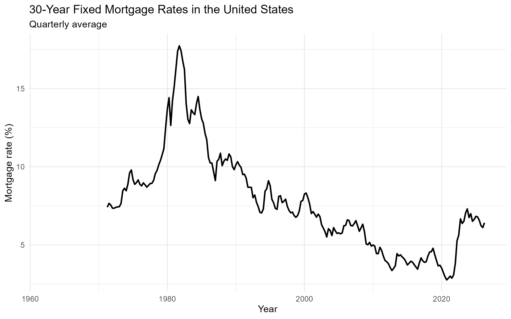
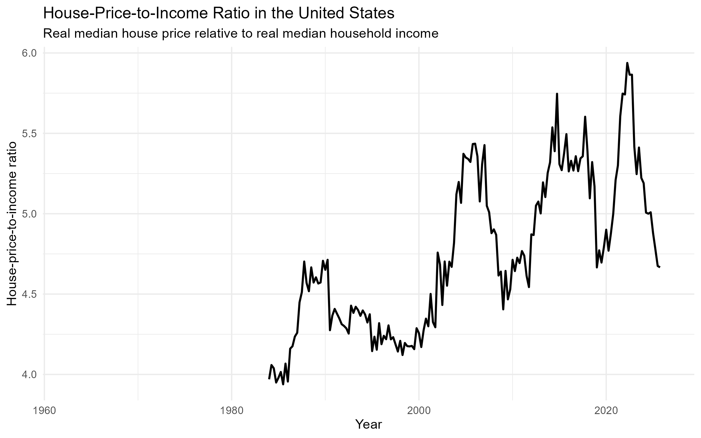

## Research Question

Buying a home today feels impossible for many Americans. But is this purely because houses are getting too expensive? Not necessarily. A booming housing market might be offset by rising incomes, and high price tags can sometimes be swallowed if borrowing costs are historically low.

This blog answers the following question:
**How has housing affordability in the United States changed over time, and what roles have house prices, mortgage rates, and household income played in this change?**

## Data and Method

To investigate this, I used historical data from the Federal Reserve Bank of St. Louis (FRED) through API access. I looked at three key variables: the median sales price of new houses, the 30-year fixed mortgage rate, and the real median household income.

The observation window is 1963-2024, and variables are recorded on a seasonal basis (income data was coded  only since 1980s). To ensure an apples-to-apples comparison over decades, I adjusted nominal house prices and incomes for inflation using the Consumer Price Index (CPI).

The analysis is conducted with three figures. The first and second firueres respectively use the variables of real housing price and 30-year mortgage rate. For the third graph, I calculate a price-to-income ratio that directly compares the cost of an average house to the average household's purchasing power.

## Visualization Strategy

I use three time-series visualizations to analyze the trend on housing affordability. Each visualization focuses on a different component of housing affordability, and together they provide a broader picture of how the housing market has changed.

The first visualization plots the median sales price of new houses in constant 2025 U.S. dollars. Looking at the real house prices, there is a long-run upward trend in general. Despite a few temporary downturns that might be correlated with macro economic recessions (like the 2008 financial crisis), the general trend goes up, and the level of real house prices is considerably higher in the 2020s than it was during the 1960s. The price approximately doubled over the past 60 years.

The house price alone doesn't tell the whole story. The second visualization plots the quarterly average 30-year fixed mortgage rate. Mortgage rates represent the cost of financing a home purchase. At a same house price, a higher mortgage rate lowers the affordability.

The figure shows that the 30-year mortgage rate grew to approximately 18% in 1963-1980, then gradually declined for decades until 2020. The decline became particularly pronounced during the COVID-19 period, when mortgage rates reached a level of around 3%. After 2021, mortgage rates recovered significantly from the bottom level to around 7%.

This pattern implies that housing price alone cannot fully describe housing affordability during some period of times. During 1980-2020, the lowered cost of financing accompanied the rising real house price, keeping house affordability somewhat affordable. By contrast, the high house price in the 2020s combined an increase in mortgage rate created a worsened affordability environment.

The third visualization plots the ratio of real median house prices to real median household income, which directly compares the cost of housing with household income. Intense fluctuations are observed, with the cycle's peak increasing each time.

The ratio was relatively stable around 4 in the mid-1980s and early 1990s. It then increased during the late 1990s and early 2000s, reaching 5 before the housing market crisis.

The ratio declined significantly when the financial crisis came in the late 2000s, which is consistent with the sharp decline in house prices shown in Figure 1.

After the financial crisis, the ratio recovered. During the 2010s, housing prices grew faster than household income, pushing the ratio upward, and then a setback came again in the late 2010s. The increase went sharp during 2020–2023, when the ratio approached 6.

The post-pandemic decline after 2022 is also clearly illustrated from the graph. The ratio falls substantially from its peak as real house prices declined. However, our graph 2 complements the explanation of regularity here, as mortgage rates increased substantially during the same period, which means that the cost of financing a home became considerably higher even though the price-to-income ratio declined. This comparison between Figures 2 and 3 indicates that the price-to-income ratio and mortgage rates capture different dimensions of affordability, which are both significant.

## Takeaway

Method: I used Census FRED API data to analyze three core components of housing: inflation-adjusted house prices, 30-year mortgage rates, and the price-to-income ratio.

Wage-Price Disconnect: Real house prices have surged over the long run, significantly outpacing household income growth and pushing the price-to-income ratio to historic highs.

The Rate Illusion: Historically low mortgage rates countered the severity of rising house prices in 1980-2020, temporarily keeping monthly payments somewhat affordable.

The Double Squeeze: The recent post-pandemic spike in mortgage rates, combined with already high housing prices, has fundamentally worsened the economic burden for potential homebuyers.

Core Insight: Housing affordability is not just about the price tag; it relies heavily on the interaction between prices, income, and borrowing costs. Looking at any single indicator fails to capture the true financial burden on American households.