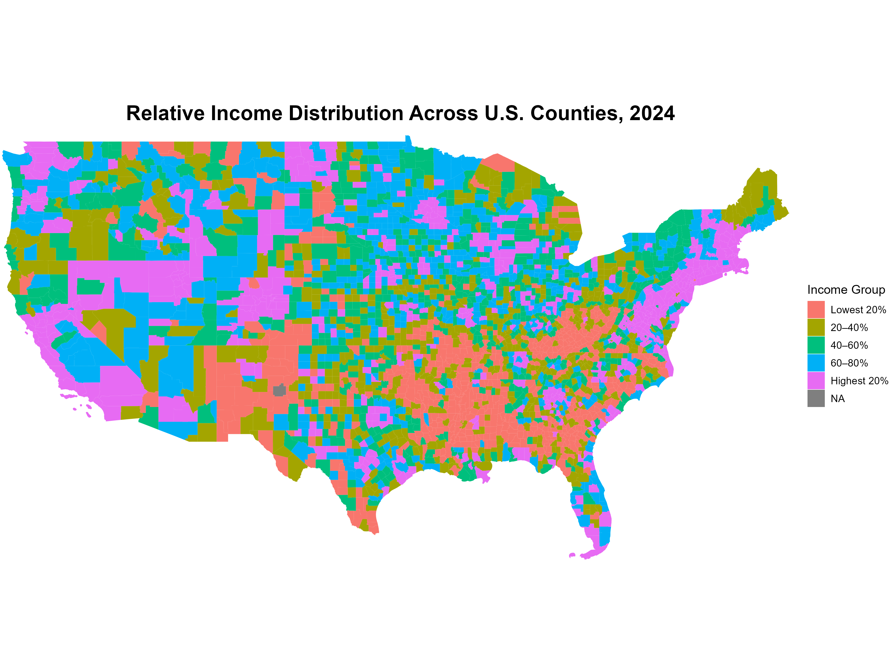
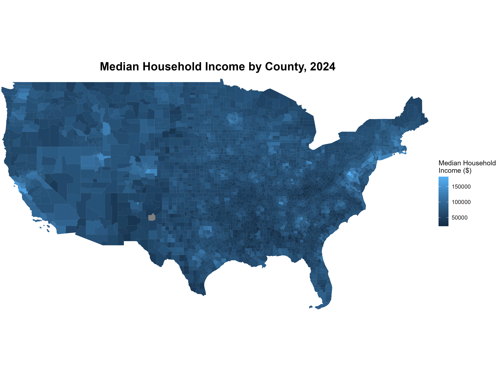
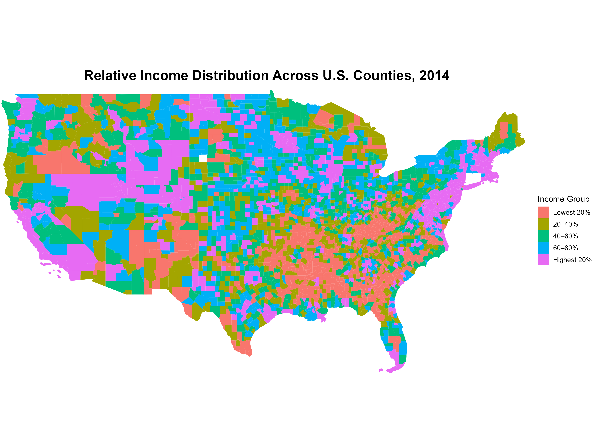

## Research Question

Is the American Dream geographically concentrated? As the national debate around inequality deepens, we explore the geographical distribution of people at different income levels. We look beyond national averages and zoom into the county level, which is the building blocks of local economies.

In this blog, we attempt to answer the following question:
**What is the geographical distribution of high- and low-income counties in the U.S., and is this spatial characteristic changing over time?**

## Data and Method

To conduct this analysis, we extract data county-level median household income from the U.S. Census Bureau through API, drawing on the American Community Survey (ACS). Because single-year ACS estimates only cover heavily populated areas, we used ACS 5-year estimates to ensure complete, reliable geographic coverage across the entire country. The latest round of statistics come from 2024, and we also extract statistics from a decade ago (2014) for comparative analysis.

Using R, we merge median household income data with geographic boundary shapefiles at the county level. To untangle genuine spatial shifts from the effects of inflation, we calculate each county's relative income rank by assigning them to quintiles from the lowest 20% to the highest 20% nationally. In this way, we get to map the distributions of relative county-level income to the spatial map.

## Analytical Findings - The Current Landscape: 2024

The relative county-level income distribution map for 2024 reveals a clear geographic polarization. High-income counties (the top 20%) are not scattered randomly; they are tightly clustered along the Northeast Corridor, the West Coast tech hubs (like the Bay Area and Seattle), and a handful of booming inland metros (e.g., Denver, Austin, Nashville). Conversely, the lowest-income counties (bottom 20%) form a massive, contiguous block across the American South, stretching from the Appalachian Mountains down through the Mississippi Delta, alongside pockets of the Southwest.

To validate this, the absolute median household income map (our median income data is directly used to map this) corroborates our findings. The spatial patterns align perfectly: the darkest, wealthiest counties (often exceeding 150,000 in median income) correspond to the coastal pink clusters, while the lowest brackets (frequently below 50,000) mirror the Southern red belt. This tells us that the relative ranking does reflect real wealth gaps between regions.

## Analytical Findings - A Decade of Change: 2014 versus 2024

When we compare 2024 to a decade ago (2014), the general revelation is the stickiness of spatial inequality. The economic landscape of the wealthy coasts and the impoverished South remain remarkably unchanged.

Under the general revelation, a closer look reveals a hardening Matthew Effect (the rich get richer). Over the decade, certain suburban and exurban counties adjacent to major metropolitan hubs have shifted from middle-tier to top-tier categories. Meanwhile, many rural counties in the Midwest and South that were previously middle-income have slipped down the rankings. The map shows a subtle but significant consolidation of high-income status into fewer, more concentrated metro areas, while the areas left behind are sprawling.

## Takeaway

**Method**: We extract Census ACS 5-year estimates and use R to map county-level relative income quintiles across the U.S. for both 2014 and 2024.

**Spatial Polarization**: The map reveals severe geographic clustering, with high-income counties concentrated on the coasts and low-income counties forming a massive, contiguous block across the South region.

**Structural Stickiness**: A decade-over-decade comparison shows strong persistence, as the broad geographic contours of wealth and poverty remain mainly unchanged.

**Metropolitan Concentration**: Over time, an emerging "Matthew Effect" is visible, with wealth further concentrating into core metropolitan hubs, while many rural counties slip down the relative rankings.

**Core Insight**: American income inequality fundamentally has spatial regularities, as economic opportunity and mobility remain tied to one's zip code.