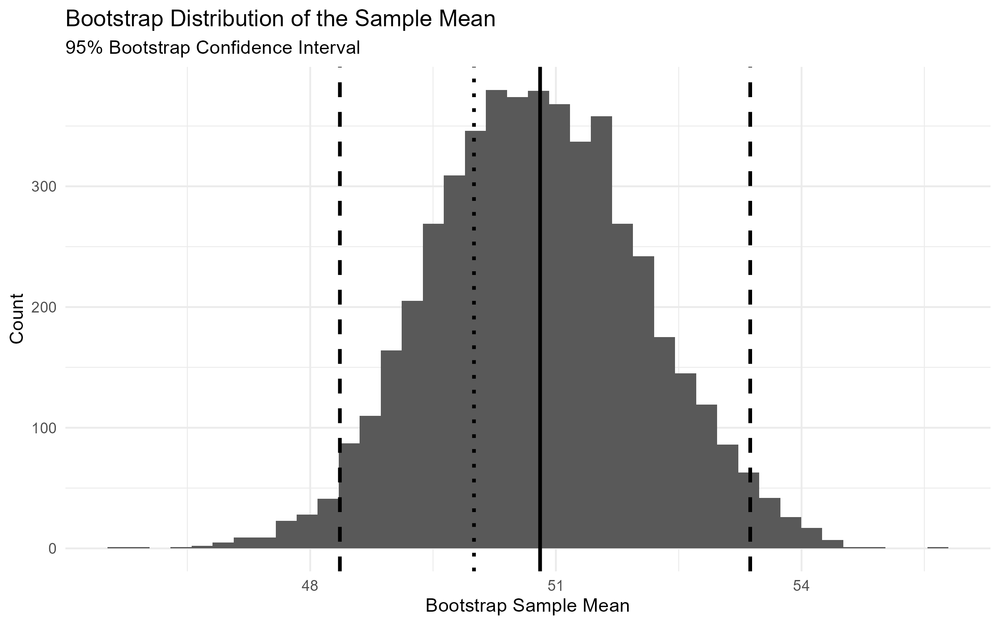
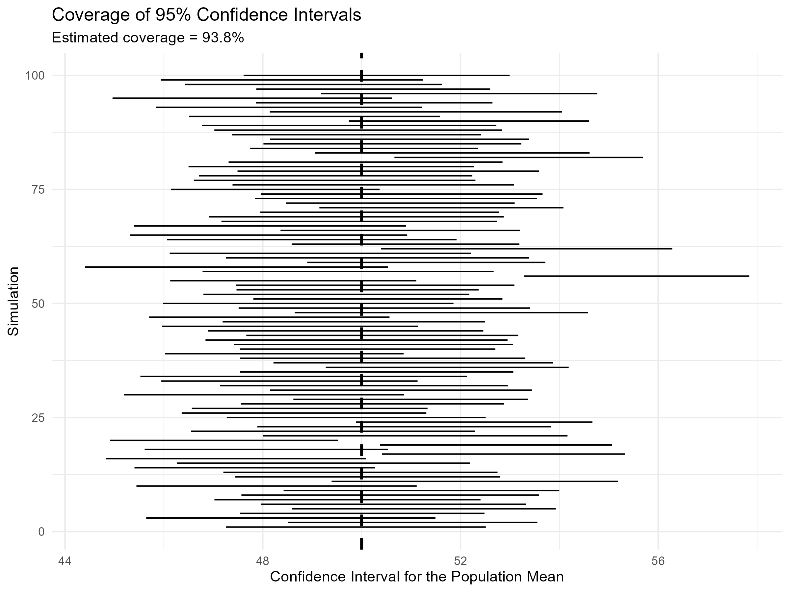
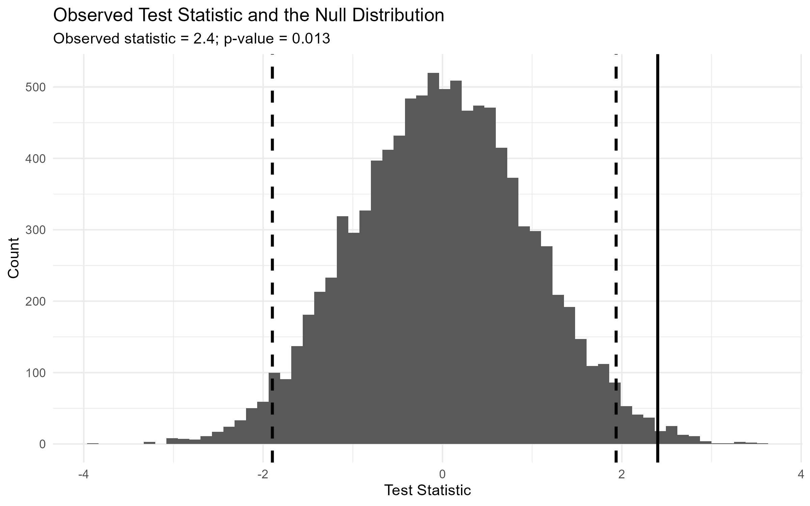

## Introduction

Statistical inference allows us to use sample data to draw conclusions about a population. Two common tools are confidence intervals and hypothesis tests. Although their formulas are relatively straightforward, it can be less intuitive to understand what they actually tell us.

In this post, I use simulation to illustrate how these methods work. By repeatedly generating samples and examining the resulting distributions, we can see how uncertainty is measured and how statistical evidence is evaluated.

The post covers three related questions: 

How can we construct a bootstrap confidence interval from a single sample? 

What does it mean for a 95% confidence interval to have 95% coverage? 

How do hypothesis tests use a null distribution to determine whether an observed result is statistically significant?

## 1. Constructing a Bootstrap Confidence Interval

Suppose we draw 50 observations from a population with a mean of 50 and a standard deviation of 10. In practice, the population distribution is usually unknown, and we have only an observed sample. The bootstrap uses that sample to approximate the sampling distribution of an estimator. Because resampling is done with replacement, an observation may appear more than once in a bootstrap sample, while another may not appear at all.

I repeatedly draw new samples from the original sample, with replacement, and calculate the mean of each resample. Repeating this process 5,000 times produces a bootstrap distribution of the sample mean.

The histogram shows the 5,000 bootstrap means. The solid line marks the original sample mean, the dashed lines mark the 95% interval bounds, and the dotted line marks the true population mean.

The central 95% of the bootstrap distribution forms the interval:

$$
CI_{95\%}
=
\left[
Q_{0.025},
Q_{0.975}
\right]
$$

where $Q_{0.025}$ and $Q_{0.975}$ are the 2.5th and 97.5th percentiles.

### Try It Yourself

The interactive visualization lets readers change the sample size, number of bootstrap samples, confidence level, and true population mean.

<iframe
  src="figure/bootstrap_interactive.html"
  width="100%"
  height="700px"
  frameborder="0">
</iframe>

A larger sample generally produces a narrower distribution, while more replications make its shape more stable. A higher confidence level produces a wider interval.

## 2. Understanding 95% Confidence Interval Coverage

To understand a 95% confidence level, we need to repeat the sampling process.

I generate 1,000 independent samples from the same population. For each sample, I construct a bootstrap confidence interval and check whether it contains the true mean of 50.

Each horizontal line represents one of the 100 confidence intervals displayed, while the vertical dashed line marks the true population mean. The reported coverage rate of 93.8% is calculated from all 1,000 simulations. **93.8% of the intervals contain the true mean**, close to the 95% target. The difference reflects random variation across a finite number of simulations.

A 95% confidence level therefore describes long-run coverage: approximately 95% of intervals from repeated samples should contain the true parameter. It does not mean a particular calculated interval has a 95% probability of containing it.

## 3. Simulating a Hypothesis Test

Suppose we test whether the population mean differs from 50:

$$
H_0: \mu = 50
$$

$$
H_1: \mu \neq 50
$$

I generate 10,000 samples under the null hypothesis, with population mean 50 and standard deviation 10, and calculate for each sample:

$$
Z =
\frac{\bar{X}-\mu_0}
{\sigma/\sqrt{n}}
$$

The resulting values form an empirical null distribution.

The null distribution is centered around zero. Values near zero are common, while tail values are less frequent.

For a two-sided test with significance level $\alpha=0.05$, the most extreme 5% of the null distribution forms the rejection region. The dashed lines mark its critical boundaries. An observed statistic beyond either boundary is sufficiently unusual under the null hypothesis to reject $H_0$ at the 5% level.

## 4. From Rejection Regions to p-Values

The rejection region gives a decision rule for a chosen significance level. A p-value measures how extreme the observed statistic is relative to the null distribution.

Suppose the observed statistic is:

$$
z_{obs}=2.4
$$

The solid line marks the observed test statistic of 2.4, while the dashed lines indicate the critical values for a two-sided test at the 5% significance level. Since 2.4 exceeds the upper critical value, the observed statistic falls in the rejection region. The p-value measures the probability in both tails beyond ±2.4, rather than simply the area beyond the observed value on the right.

For a two-sided test, we count simulated statistics at least as far from zero as the observed value:

$$
|Z| \geq |z_{obs}|
$$

The simulated p-value is:

$$
p
=
P\left(|Z|\geq |z_{obs}| \mid H_0\right)
$$

The estimated p-value is **0.013**, meaning that approximately 1.3% of the simulated statistics under the null hypothesis are at least as extreme as the observed statistic. For a two-sided test, this includes unusually large positive and negative values.

Since

$$
0.013 < 0.05,
$$

we reject the null hypothesis at the 5% significance level.

The rejection region is set by the significance level; the p-value measures the observed statistic's extremeness. It is not the probability that the null hypothesis is true.

## Takeaways

- **Bootstrap resampling approximates sampling uncertainty.** Repeatedly drawing samples with replacement produces a distribution that can be used to construct a confidence interval.
- **A 95% confidence level describes long-run coverage.** In this simulation, 93.8% of the intervals contained the true population mean, illustrating coverage close to the intended rate.
- **The null distribution provides a reference for hypothesis testing.** It shows which test-statistic values are common or unusual when the null hypothesis is true.
- **Rejection regions and p-values are related but distinct.** The rejection region sets a threshold based on the significance level, while the p-value measures how extreme the observed statistic is under the null.

Simulation connects statistical formulas to the distributions generated by repeated samples.