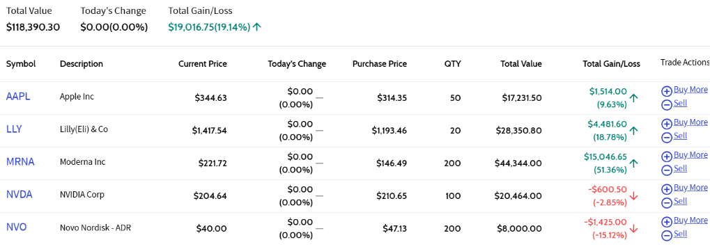
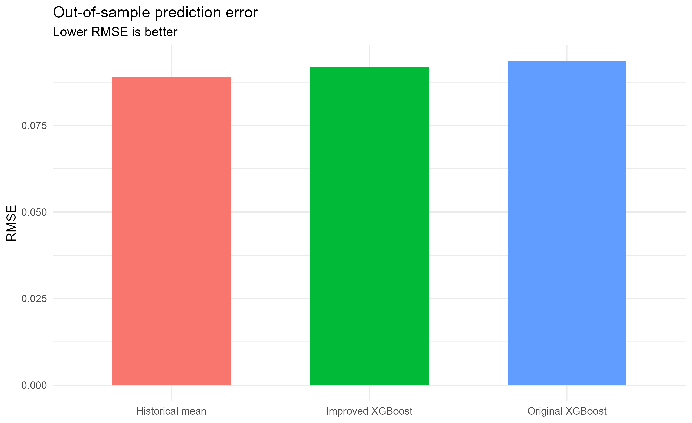
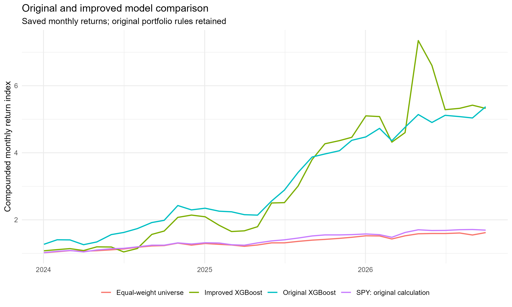

## Introduction

In our class, we explored whether financial analysis could help investors select stocks more effectively than intuition alone. Each team created two portfolios: one based on subjective choices and another informed by financial analysis. We also examined an XGBoost model that used historical market data to predict future stock returns.

This post evaluates whether improving gradient boosting models may help with investment strategies. I revisit the classroom experiment and test a modified version of that model. I compare the original and revised models on the same test observations, then examine whether changes in prediction accuracy translate into better investment performance.

## 1. What can we learn from the class experiment?

Each portfolio started with $100,000. Portfolio 1 used subjective selection, while Portfolio 2 drew on analytical tools introduced in class, including correlations, Sharpe ratios, Jensen’s alpha, portfolio optimization, and return prediction.

Across 45 teams, Portfolio 1 earned an average return of 1.18%, compared with 3.09% for Portfolio 2. The analyzed portfolio finished ahead in 30 teams.

{#fig-class fig-alt="Scatterplot comparing subjective and analysis-based portfolio returns for 45 teams."}

The average paired advantage was 1.91 percentage points, or approximately $1,909. However, the 95% confidence interval ranged from −0.38 to 4.20 percentage points, with a two-sided p-value of 0.100. The results suggest a possible benefit from analysis, but leave considerable uncertainty.

My own subjective portfolio experiment, designed intuitively with a classmate, held Apple, Eli Lilly, Moderna, NVIDIA, and Novo Nordisk. The screenshot records a total value of $118,390.30 and a net gain on the holdings of $19,016.75.

{#fig-own fig-alt="Portfolio screenshot listing Apple, Eli Lilly, Moderna, NVIDIA, and Novo Nordisk, with Moderna contributing the largest gain."}

Moderna contributed $15,046.65—about 79% of the holdings’ net gain—while NVIDIA and Novo Nordisk lost value. A strong result can therefore depend heavily on one successful stock.

This helps explain why returns are difficult to predict. Future news is unknown, market conditions change, and patterns that appear useful in one sample may disappear in another.

## 2. How did I modify the original model?

I obtained daily prices and trading volume for the classroom’s 95 stocks and SPY from [Yahoo Finance](https://finance.yahoo.com/) through R’s `tidyquant` package.

After constructing the predictors, the training sample contains 35,625 observations dated before 2024. The test sample contains 66,595 observations dated from January 2024 through October 2026.

The prediction target follows the classroom definition: the adjusted-price return between the next trading day’s close and the twentieth future trading day’s close.

The original model uses XGBoost, which builds decision trees sequentially to address earlier prediction errors. Its settings include 300 trees, depth five, and a learning rate of 0.05. Predictors include prices, volume, momentum, volatility, and market-adjusted returns.

For the revised model, I replaced raw price levels with proportional indicators, including momentum, market-relative momentum, volume ratios, and distance below the trailing high. These measures describe recent performance without depending directly on a stock’s price level.

I also used 500 shallower trees, depth three, a learning rate of 0.03, and stronger regularization. Row and column sampling further reduce reliance on particular observations or predictors. These settings were fixed before evaluating the results.

Both models use identical training and test observations, return targets, and portfolio calculations.

## 3. Did prediction accuracy improve?

The simple benchmark assigns every stock the historical average return calculated from the training sample.

| Model | RMSE | Out-of-sample R² | Direction accuracy | Mean daily rank correlation |
|:--|--:|--:|--:|--:|
| Historical mean | **0.08887** | 0.0000 | **56.06%** | — |
| Original XGBoost | 0.09354 | −0.1079 | 52.46% | **0.0405** |
| Improved XGBoost | 0.09184 | −0.0679 | 51.00% | 0.0212 |

: Lower RMSE indicates smaller prediction errors. Daily rank correlation measures whether predicted stock rankings match subsequent return rankings. {#tbl-predictions}

The revised model reduced RMSE by approximately 1.82% relative to the original. MAE also decreased, from 0.06830 to 0.06683.

{#fig-rmse fig-alt="RMSE comparison showing the historical mean performing best, followed by improved and original XGBoost."}

However, direction accuracy and ranking performance declined. Both models also had negative out-of-sample R², meaning that neither beat the historical mean on squared prediction error. The changes improved return-magnitude estimates only modestly.

## 4. Did the changes produce better investment performance?

Each month, both models select the ten highest-predicted stocks and apply the classroom portfolio procedure. The comparison includes 34 monthly portfolios, from January 2024 through October 2026.

{#fig-investment fig-alt="Compounded monthly return indices showing similar final model values but larger fluctuations for improved XGBoost."}

| Strategy | Cumulative return | Monthly return standard deviation | Monthly-endpoint maximum drawdown |
|:--|--:|--:|--:|
| Original XGBoost | **437.39%** | 8.66% | −11.80% |
| Improved XGBoost | 432.37% | 16.35% | −28.06% |
| Equal-weight universe | 61.93% | 2.97% | −7.29% |
| SPY | 69.26% | 3.18% | −6.28% |

: Hypothetical results calculated using the classroom backtest procedure. Cumulative values compound monthly returns; risk measures use monthly observations. {#tbl-investment}

The model indices exceeded both simple benchmarks, but the revised model offered no improvement over the original’s final return. Its monthly volatility was approximately 1.89 times as large, and its drawdown was deeper.

Interestingly, its average monthly return was higher: 6.15%, versus 5.41%. Compounding explains the difference. Larger fluctuations can reduce long-run growth, so a higher arithmetic average does not guarantee a higher final value.

## Takeaway

The revised XGBoost model slightly reduced prediction errors, but weakened direction and stock-ranking accuracy. Its investment result was close to the original’s, with substantially greater variation.

My main takeaway is that improving a forecasting score is only one part of evaluating a stock-selection model. The predictions must also lead to useful rankings and an investment outcome whose returns justify the fluctuations experienced along the way.