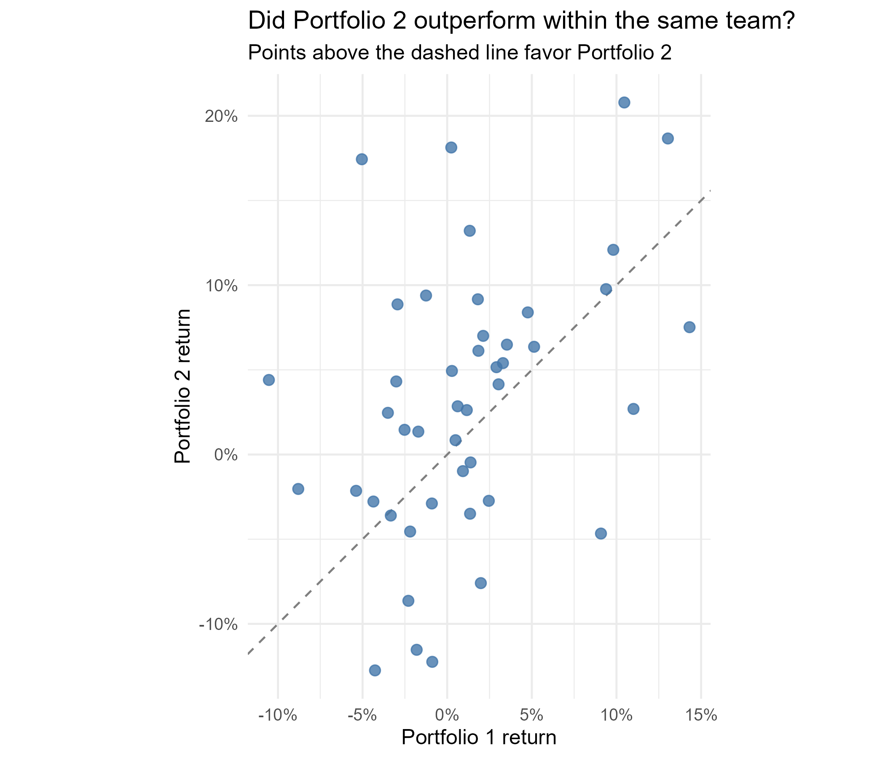
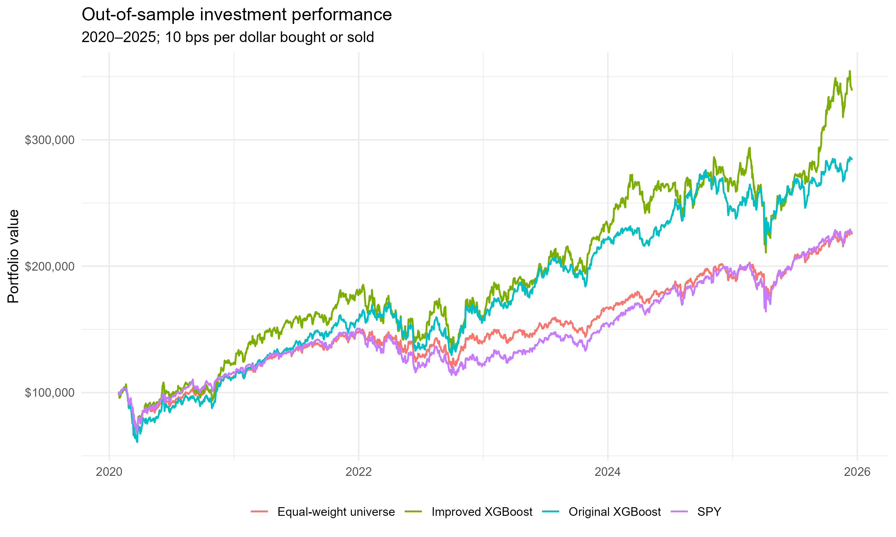
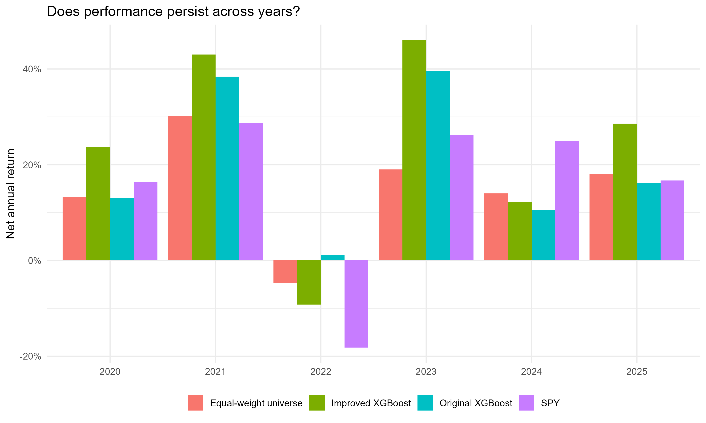
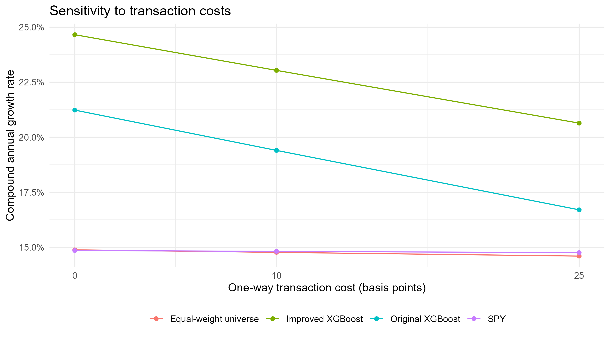

An improved stock-selection model earned a 23.04% annualized return in my backtest, after estimated trading costs. Buying and holding SPY earned 14.81%. That looks encouraging. Yet the model could not forecast individual stock returns more accurately than a simple historical average.

How can both results be true? Revisiting our classroom experiment and testing two gradient boosting models helps separate three questions: whether analysis helps, whether predictions improve, and whether those predictions support a useful investment strategy.

## 1. Did analysis help in class?

Each team began with two $100,000 portfolios: one selected subjectively without analysis, and another selected after analysis. The specific analytical methods were not documented.

Across 45 teams, the first portfolio earned an average return of 1.18%, compared with 3.09% for the second. The analyzed portfolio finished ahead in 30 teams.

{#fig-class fig-alt="Scatterplot comparing subjective and analyzed portfolio returns across 45 teams, with a diagonal equality line."}

The average advantage was 1.91 percentage points, or about $1,909. However, its paired-test 95% confidence interval ranged from −0.38 to 4.20 percentage points, with a two-sided p-value of 0.100. A paired bootstrap interval also included zero.

The results suggest a possible benefit, but leave substantial uncertainty. They also cannot establish causality: teams chose different stocks and used unspecified analytical methods.

Stock prediction faces deeper obstacles. Prices respond rapidly to information, future news is unknown, and historical relationships can change. A flexible model can also mistake random fluctuations for repeatable patterns.

## 2. Building a more cautious model

I downloaded daily prices and volume for 50 established U.S. stocks across several industries, plus SPY, from [Yahoo Finance](https://finance.yahoo.com/) using R's [quantmod](https://www.quantmod.com/) interface. Data cover 2010–2025, with adjusted prices used to calculate returns.

The baseline reconstructs the classroom-reference XGBoost model on this common sample. XGBoost builds successive decision trees that correct earlier prediction errors. The baseline uses 300 trees, depth five, and a learning rate of 0.05, with price, volume, momentum, volatility, and market-return predictors.

My improved version removes raw price levels, redefines momentum, and adds scale-free measures: market-relative momentum, volume ratios, and distance below the past year's high. Shallower trees, stronger regularization, and row and column subsampling limit complexity.

I selected settings using 2018–2019 validation data. The winning model used 200 trees of depth two and an expanding training window. It was retrained annually; the baseline remained fixed at the start of testing.

Final evaluation uses 2020–2025 data: 74 prediction dates and 3,700 stock-level forecasts. At every training cutoff, only already-realized return labels were available. Signals occur every 20 trading days, with entry at the following close and exit 20 trading days later.

## 3. Better forecasts, but a simple average still wins

The prediction benchmark assigns every stock the average return observed in the pre-test training sample.

| Model | RMSE | Out-of-sample R² | Mean rank correlation |
|:--|--:|--:|--:|
| Historical mean | **0.08433** | 0.0000 | — |
| Original XGBoost | 0.08951 | −0.1266 | 0.0130 |
| Improved XGBoost | 0.08486 | −0.0125 | 0.0288 |

: Prediction results on the same out-of-sample observations. Lower RMSE is better; positive R² indicates improvement over the historical-mean benchmark. Rank correlation measures stock-ordering accuracy within each prediction date. {#tbl-predictions}

The improved model reduced RMSE by 5.20% relative to the original. A time-block bootstrap supported this reduction. Nevertheless, its negative R² shows that the historical mean remained more accurate.

Ranking improved too, but the average correlation of 0.0288 indicates a weak signal.

## 4. What would an investor have earned?

Both model portfolios held the ten highest-ranked stocks at equal weights. Comparisons use identical holding intervals, an equal-weight portfolio of all 50 stocks, and buy-and-hold SPY.

Trading costs depend on actual buys and sells after allowing holdings to drift with prices. The main scenario charges 10 basis points, or 0.10%, per dollar bought or sold.

{#fig-wealth fig-alt="Daily portfolio values showing improved XGBoost ending near 339,000 dollars, original XGBoost near 284,000, and both benchmarks near 225,000."}

| Strategy | Annualized return | Annualized volatility | Sharpe ratio | Maximum drawdown |
|:--|--:|--:|--:|--:|
| Original XGBoost | 19.40% | 24.93% | 0.84 | −41.31% |
| Improved XGBoost | **23.04%** | 28.80% | **0.87** | −35.98% |
| Equal-weight universe | 14.77% | 20.22% | 0.78 | −33.43% |
| SPY | 14.81% | 20.88% | 0.77 | −33.72% |

: Net investment performance at 10 bps per dollar traded. Sharpe ratios assume a zero risk-free rate. Drawdowns use daily wealth. {#tbl-investment}

Selecting only the highest-ranked stocks can produce gains even when forecasts across the full sample remain inaccurate. Here, however, higher returns came with greater volatility, and the Sharpe improvement over the original model was modest.

{#fig-annual fig-alt="Grouped annual-return bars showing that improved XGBoost does not outperform every year."}

Time-block bootstrap intervals for the improved strategy's average holding-period return advantage over each comparator all included zero. The observed gains therefore remain uncertain.

{#fig-cost fig-alt="Transaction-cost sensitivity showing model annualized returns declining more sharply than benchmark returns."}

## Takeaway

The changes improved forecasts relative to the original model and produced higher returns in this backtest. They did not establish dependable market-predicting ability. The historical mean remained the better point forecast, investment advantages were imprecisely estimated, and the fixed stock sample introduces survivorship and selection bias.

A useful evaluation must examine prediction errors, investment risk, costs, and uncertainty together. An impressive final portfolio value answers only part of the question.

---

**Sources and reproducibility.** Classroom results: course-provided `Full_Result.xlsx`. Market data: Yahoo Finance, accessed through `quantmod`, with cached daily observations for 2010–2025. The classroom-reference XGBoost script is archived in [this repository](https://github.com/Changlin-DU/Stock_Returns/blob/main/code/original/original_xgboost.R). My analysis changes the sample, training periods, and evaluation rules; it is a reconstruction rather than an exact replication. All reported results come from the accompanying R analysis.